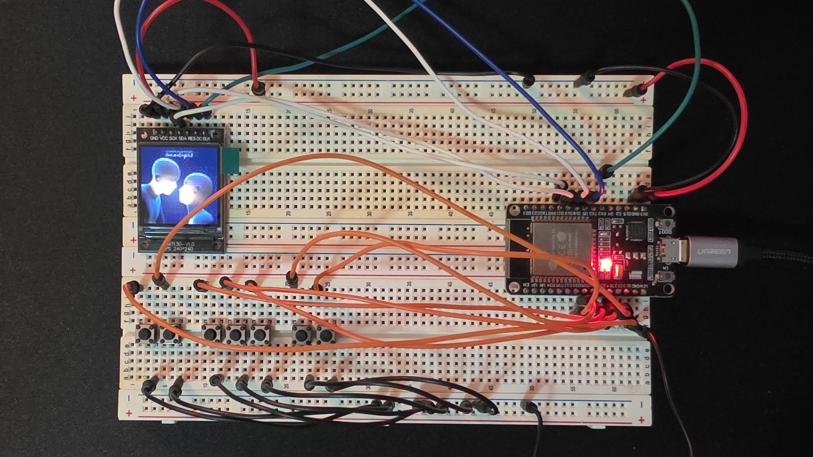
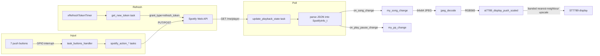

<div id="top"></div>
<br/>
<br/>
<br/>

<p align="center">
  
</p>
<h1 align="center">
    <a href="https://github.com/Armaggheddon/ESP32_spotify_controller">ESP32 Spotify Controller</a>
</h1>
<p align="center">
    <a href="https://github.com/Armaggheddon/ESP32_spotify_controller/commits/master">
    
    </a>
    <a href="https://github.com/Armaggheddon/ESP32_spotify_controller">
    
    </a>
    <a href="https://github.com/Armaggheddon/ESP32_spotify_controller/issues">
    
    </a>
    
    
</p>
<p align="center">
    Your Spotify, now with real buttons! 🎵🔊
    <br/>
    <br/>
    <a href="https://github.com/Armaggheddon/ESP32_spotify_controller/issues">Report Bug</a>
    •
    <a href="https://github.com/Armaggheddon/ESP32_spotify_controller/issues">Request Feature</a>
</p>

A physical remote for Spotify, built on an ESP32. It shows the album art of the
current track on a 240x240 screen and gives you real buttons for the controls you
actually reach for: play/pause, next, previous, volume, shuffle, repeat, and a
one-tap save to Liked Songs.

> `src/main.c` is an example of how to drive the library, not a fixed reference.
> Treat it as a starting point and reshape it for your build. See
> [Customizing](#customizing).

## What it can do

| | |
|---|---|
| **Now playing** | Album art on a 240x240 ST7789 SPI display, redrawn whenever the track changes |
| **Playback** | Play/pause, next, previous, volume up and down, shuffle and repeat |
| **Liked Songs** | Save the track that is playing with one button |
| **Devices** | Move playback to another Spotify Connect device |
| **Callbacks** | Hooks for track changes and play/pause changes, in full or lightweight form |
| **Authorization** | The access token renews itself; a helper on your PC fetches the refresh token |
| **Footprint** | Around 1.03 MB of flash (68.8% of the 1500K app partition) and 80 KB of RAM (24.4%) |

A **Spotify Premium** account is required. The Web API refuses playback control
requests from free accounts.

## How it works



Two background tasks keep the firmware alive. One renews the access token, which
Spotify only honours for an hour, and re-runs the exchange every 58 minutes. The
other asks Spotify what is playing every 200 ms and calls you back when something
actually changed, so you get one event per track instead of a poll you have to
diff yourself.

Button presses arrive as GPIO interrupts, land in a queue, and are handled outside
the interrupt so the ISR stays short. Each action then runs in its own short-lived
task, which means a slow HTTP request can never swallow the next press.

The internals, including the task table, buffer sizes and boot order, are written
up in [`docs/architecture.md`](docs/architecture.md).

## Hardware

- An ESP32 dev board
- An ST7789 240x240 SPI display. The build does not use CS, so a breakout without
  that pin works fine
- Seven momentary push buttons, optional. Set `USE_BUTTONS 0` to leave them out

### Wiring

```
                       ┌───────────────────┐
                       │  ESP32 dev board  │
                       └───────────────────┘

  ST7789 240x240 (SPI2)              7 x momentary buttons
  ─────────────────────              ──────────────────────
   VCC  ─────────→  3V3               GPIO 33 ──→ VOLUME_UP
   GND  ─────────→  GND               GPIO 25 ──→ VOLUME_DOWN
   SCLK ─────────→  GPIO 21           GPIO 26 ──→ SKIP_NEXT
   MOSI ─────────→  GPIO 19           GPIO 32 ──→ PLAY_PAUSE
   RES  ─────────→  GPIO 18           GPIO 14 ──→ SKIP_PREVIOUS
   DC   ─────────→  GPIO 5            GPIO 13 ──→ REPEAT_MODE
   BLK  ─────────→  GPIO 4            GPIO 12 ──→ SHUFFLE
   CS   ── not connected              other leg ──→ GND (active low)
```

The display runs on SPI2 at 20 MHz:

| Signal | GPIO |
|--------|------|
| `DISPLAY_SCLK` | 21 |
| `DISPLAY_MOSI` | 19 |
| `DISPLAY_RES` | 18 |
| `DISPLAY_DC` | 5 |
| `DISPLAY_BLK` | 4 |
| CS | not used (`-1`) |

Every button is wired the same way: one leg to the GPIO, the other to GND. A press
pulls the pin low, and the ESP32's internal pull-ups hold it high while released, so
presses show up as falling edges (`BUTTON_INTR_EDGE = GPIO_INTR_NEGEDGE`).

| Function | GPIO |
|----------|------|
| `BUTTON_VOLUME_UP` | 33 |
| `BUTTON_VOLUME_DOWN` | 25 |
| `BUTTON_SKIP_NEXT` | 26 |
| `BUTTON_PLAY_PAUSE` | 32 |
| `BUTTON_SKIP_PREVIOUS` | 14 |
| `BUTTON_REPEAT_MODE` | 13 |
| `BUTTON_SHUFFLE` | 12 |

> Keep button pins away from the `DISPLAY_*` pins (21, 19, 18, 5 and 4).
> `buttons_start()` runs after the display is set up and reconfigures whatever pins
> it is given, which will take the display down with it. Leave GPIO 12 and 15 alone
> as well if you plan to fit external pull-ups: both are strapping pins sampled at
> boot, and a high level on GPIO 12 selects 1.8 V flash.

Every pin is a `#define` at the top of `src/main.c`.

## Quick start

### 1. Prerequisites

- [PlatformIO](https://platformio.org/), either the VS Code extension or the CLI
- Spotify Premium, plus an app you create in the Spotify Developer Dashboard, with
  **Web API** selected. You will need its **Client ID** and **Client Secret**. The
  [getting started guide](https://developer.spotify.com/documentation/web-api/tutorials/getting-started)
  walks through creating one
- [uv](https://docs.astral.sh/uv/) to run the authorization helper. The script uses
  only the standard library, so there is nothing to install

### 2. Configure credentials

Create `include/my_credentials.h`. It is gitignored, so your secrets stay out of the
repository:

```c
#ifndef APP_DEFINES_H
#define APP_DEFINES_H

#define WIFI_SSID "your-wifi-ssid"
#define WIFI_PSWD "your-wifi-password"

#define SPOTIFY_CLIENT_ID       "your-client-id"
#define SPOTIFY_CLIENT_SECRET   "your-client-secret"
#define SPOTIFY_REFRESH_TOKEN   "filled-in-by-tools/spotify_auth.py"

#endif // APP_DEFINES_H
```

### 3. Authorize with Spotify

> Access tokens last an hour and the firmware renews them on its own. Refresh tokens
> expire after 6 months, so this is recurring maintenance rather than a one-off
> setup step. When one lapses the API answers `invalid_grant`, and the firmware says
> so in the log and points you back here.

Spotify dropped support for plain-HTTP redirect URIs, with a single exception:
loopback IP literals such as `http://127.0.0.1:PORT`. Both `localhost` and mDNS
`.local` names are rejected. That is why this step runs on your PC rather than on
the ESP32, and why re-authorizing needs no re-flash until the new token is written.

One-time dashboard setup:

1. Open your app, go to **Settings**, add `http://127.0.0.1:3000/callback` to
   **Redirect URIs** and save.
2. While the app is in Development mode, add the Spotify account you will log in
   with under **Users and Access**.

Then run the helper:

```bash
uv run tools/spotify_auth.py            # opens the browser, prints the refresh token
uv run tools/spotify_auth.py --write    # also patches include/my_credentials.h
```

It opens the browser, catches the redirect, exchanges the code, checks the result
against the API, and then either prints the refresh token or writes it into
`include/my_credentials.h`. Run it with `--help` to see the rest of the options.

Scopes requested: `user-read-playback-state user-modify-playback-state
user-library-modify`. The full story, including what to do when it fails, is in
[`docs/spotify_auth.md`](docs/spotify_auth.md).

### 4. Build and flash

```bash
pio run -e esp32dev -t upload
pio device monitor
```

### 5. Verify

Wi-Fi connects, a token comes in, and then the log fills with playback updates as
tracks change:

```
I (5872) spotify: Wi-Fi connected
I (6902) spotify: IP address obtained
I (7792) SPOTIFY: Token received
I (16752) SPOTIFY: SONG CHANGED TO Inner Light
I (16752) spotify: SUCCESS  downloading image [3050 bytes]!!
I (16792) spotify: PLAYBACK CHANGED TO PLAY
```

Pressing a button logs what it decided to do, under the `spotify` tag:

```
I (24112) spotify: 	PLAY NEXT PRESSED
I (24213) SPOTIFY: PAUSE request accepted (HTTP 204)
```

## Configuration

Most of the knobs are `#define`s at the top of `src/main.c`:

| Define | Purpose |
|--------|---------|
| `USE_DISPLAY` | Compile in the display and album art pipeline |
| `USE_BUTTONS` | Compile in the button subsystem. At `0`, all of it disappears |
| `DISPLAY_*` | Display pins, resolution and SPI clock |
| `BUTTON_*` | Button pins |
| `BUTTON_INTR_EDGE` | Interrupt edge. `GPIO_INTR_NEGEDGE` for these active-low buttons |

Two more live elsewhere. The poll rate is set in `app_main` with
`spotify_set_update_delay(...)`, and the rows sent per display transfer is
`ST7789_DISPLAY_BAND_ROWS` in `lib/s7789_display/st7789_display.h`.

## Customizing

**`src/main.c` is an example of using the library, not a fixed reference. Edit it
freely.** The libraries stay generic and `main.c` is what wires them together, so
that is where app-specific behaviour belongs. Restructure it, drop the display,
swap the buttons for a rotary encoder, add features that are not here yet. Nothing
in there is off limits.

Three places cover most of what you will want to change:

1. **Pins.** The `#define`s at the top of the file.
2. **What each button does.** The `switch` in `task_buttons_handler`. This is where a
   physical button meets the Spotify API: add or change a `case` to call any library
   function.
3. **How the app reacts to playback.** The callbacks registered in `app_main`,
   `spotify_add_on_song_change_cb` and `spotify_add_on_play_pause_change_cb`.

Hooking a button up to a feature is one `case`:

```c
// src/main.c, task_buttons_handler()
case BUTTON_ADD_TO_FAVOURITE_ID:{
    ESP_LOGI(TAG, "\tADD TO FAVOURITE PRESSED");
    spotify_action_add_currently_playing_to_favourite();   // any library call works here
    break;
}
```

### Library features

Anything in this table can be called from a button case, a callback, or a task of
your own. None of the `spotify_action_*` functions block, since each spawns a short
task and returns straight away, so they are safe to call from a button handler.

| Feature | Call | Notes |
|---------|------|-------|
| Play / pause toggle | `spotify_action_play_pause()` | Picks play or pause from the last polled state |
| Next track | `spotify_action_skip_next()` | |
| Previous track | `spotify_action_skip_previous()` | |
| Set volume | `spotify_action_set_playback_volume(uint8_t)` | 0 to 100 |
| Volume up | `spotify_action_increase_playback_volume(uint8_t)` | By the amount you pass |
| Volume down | `spotify_action_decrease_playback_volume(uint8_t)` | |
| Shuffle | `spotify_action_toggle_playback_shuffle(uint8_t)` | `SPOTIFY_TOGGLE_SHUFFLE_ON`, `_OFF` or `_AUTO` |
| Repeat mode | `spotify_action_set_repeat_mode(uint8_t)` | `SPOTIFY_REPEAT_MODE_OFF`, `_CONTEXT`, `_TRACK` or `_AUTO` |
| Save to Liked Songs | `spotify_action_add_currently_playing_to_favourite()` | Needs the `user-library-modify` scope |
| Switch device | `spotify_action_playback_to_device(char *)` | Pass a `device_id` |
| List devices | `spotify_get_available_devices()` | Where those ids come from |
| Read current state | `spotify_get_last_info()` / `spotify_get_last_info_base()` | Full struct or lightweight one |
| Album art | `spotify_get_album_cover_art_latest(size, buf, len)` | `SPOTIFY_ALBUM_ART_SIZE_64x64`, `_300x300` or `_LARGEST` |
| Album art from URL | `spotify_get_album_cover_art_from_url(url, buf, len)` | |
| Song change hook | `spotify_add_on_song_change_cb(cb)` | `..._base_cb` for the lightweight struct |
| Play/pause hook | `spotify_add_on_play_pause_change_cb(cb)` | |
| Poll rate | `spotify_set_update_delay(uint32_t)` | Milliseconds between polls |

The example uses seven of these, one per button. `BUTTON_ADD_TO_FAVOURITE_ID`
already has a dispatch case but is never registered, which makes Liked Songs the
easiest feature to add a button for. See
[`docs/architecture.md`](docs/architecture.md#add-a-button).

## Project layout

```
src/main.c                      app entry point: Wi-Fi, display, buttons, spotify_init/start
lib/spotify/                    Spotify Web API client (token refresh, polling, actions)
lib/buttons_manager/            GPIO button handling
lib/s7789_display/              ST7789 display driver with banded upscaling
lib/jpeg_decode/                album art JPEG decoder
include/my_credentials.h        secrets (gitignored)
partitions.csv                  partition table: a 1500K app partition, because the stock 1M ran out
tools/spotify_auth.py           PC-side OAuth helper that fetches a refresh token
docs/architecture.md            how it works: tasks, data flow, display pipeline
docs/spotify_auth.md            authorization, in detail
```

## Troubleshooting

- **`invalid_grant` in the logs.** The refresh token expired, or it was revoked.
  Run `uv run tools/spotify_auth.py --write` and flash again.
- **`INVALID_CLIENT`, or an `invalid redirect_uri` error.** The URI in the dashboard
  has to match what the helper sends, character for character: scheme, host, port
  and path.
- **`403 User not registered in the Developer Dashboard`.** Add your Spotify account
  under **Users and Access**.
- **A `403` or `404` when you press play/pause.** Usually there is no active
  playback device. Start playing something in a Spotify client first.
- **`Error: The program size (...) is greater than maximum allowed (...)`.** The app
  partition is full. `partitions.csv` defines a 1500K partition and
  `board_build.partitions` in `platformio.ini` selects it. Flipping
  `CONFIG_PARTITION_TABLE_SINGLE_APP_LARGE` in `sdkconfig.esp32dev` will not help;
  PlatformIO picks the CSV itself.
- **Buttons do nothing and log nothing.** Check `USE_BUTTONS` in `src/main.c`, and
  confirm the button pins do not clash with the `DISPLAY_*` pins.
- **The display stays blank.** Check the SPI pin defines and `USE_DISPLAY`.
- **Album art looks blocky.** It is. The 64x64 image Spotify returns gets upscaled
  with nearest-neighbour sampling. Ask for `SPOTIFY_ALBUM_ART_SIZE_300x300` instead
  if you would rather spend the bandwidth on sharpness.

## Documentation

- [`docs/architecture.md`](docs/architecture.md) covers the task model, the data
  flow, the display pipeline, memory constraints, and how to extend the firmware.
- [`docs/spotify_auth.md`](docs/spotify_auth.md) covers authorization: why it works
  this way, what the helper does, and how to unstick it.
